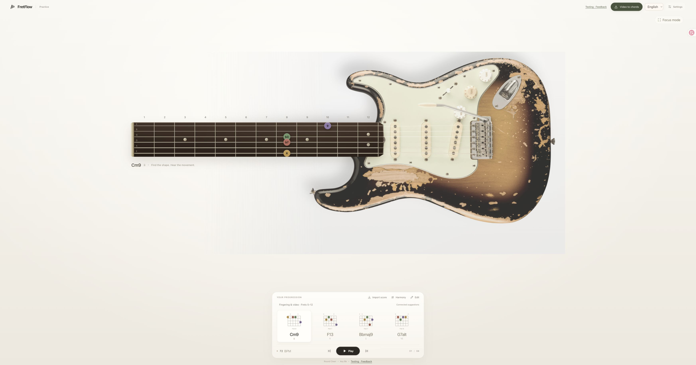

# Khalil Wu

19 y/o builder. CS @ Langara. Vancouver.

I like building small tools that become useful: AI agents, learning software, Apple Watch health experiments, and personal investing notes.

## Building: [FretFlow](https://www.fretflow.io)

**From a clip to your next riff. 从喜欢的片段，到下一次练习。**

An open-source guitar practice app that brings audio/video analysis, editable chord progressions, and an interactive fretboard into one workflow.

**[Try FretFlow →](https://www.fretflow.io)** · [Source code](https://github.com/Lfrangt/fretflow-ui) · [Feedback & ideas](https://github.com/Lfrangt/fretflow-ui/issues)

- **See the harmony:** animated chord shapes, interval labels, Roman numerals, and connected fingering suggestions.
- **Practice at your pace:** loops, tempo controls, fret-range selection, mobile layouts, and Focus mode.
- **Bring your own music:** analyze audio/video clips or import chord symbols from ChordPro, MusicXML, and Guitar Pro.
- **Keep what you learn:** export PDF charts, MIDI, MusicXML, and Guitar Pro files. English / 中文 throughout.

*Audio analysis produces editable estimates. Note, rhythm, and fingering transcription is in Beta and needs listening review.*

Built with Next.js, React, TypeScript, Python, ChordMini, and Basic Pitch.

## Other selected work

- [pulse-watch](https://github.com/Lfrangt/pulse-watch) - Apple Watch health AI app with recovery scoring and coaching
- [det-practice](https://github.com/Lfrangt/det-practice) - Duolingo English Test completion practice based on type.review
- [openclaw-multi-agent](https://github.com/Lfrangt/openclaw-multi-agent) - notes and architecture for building with AI agent teams

Currently learning computer science by shipping projects, building practical agent workflows, and keeping a long-term notebook around code, capital, music, and taste.

Links: [website](https://khalil-tech.vercel.app) / [X](https://x.com/wuhuaguor)
